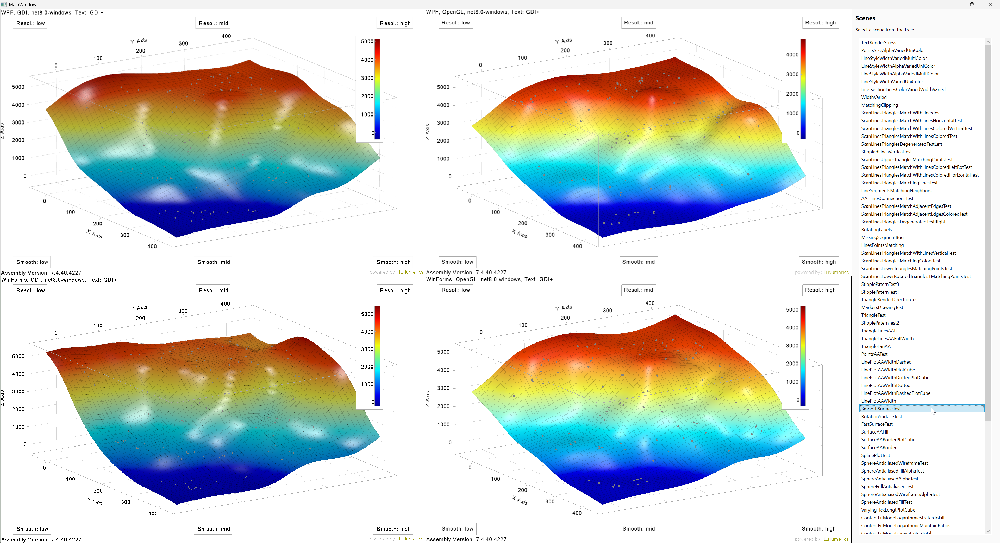

# ILNumerics.Drawing.TestApp

`ILNumerics.Drawing.TestApp` is a visual test tool used at ILNumerics to validate and compare essential features of the [ILNumerics.Drawing Visualization Engine](https://ilnumerics.net/visualization-engine.html).

The application is designed to test rendering behavior on both low-level and high-level feature layers. It can be used to demonstrate and compare the software renderer and the OpenGL renderer side by side across WinForms and WPF — all within the same user interface.



## Purpose

This project helps ILNumerics developers identify differences between renderer implementations and UI platforms and to ensure correctness of the rendering results - down to edge cases. A subset of available test scenes is published for demonstration purposes. 

The app allows interactive inspection of rendering output across four combinations:

- WinForms + Software Renderer
- WinForms + OpenGL Renderer
- WPF + Software Renderer
- WPF + OpenGL Renderer

All test scenes can be selected interactively by the user. Each scene is rendered across all supported renderer/platform combinations, making visual differences, regressions, or platform-specific behavior easy to detect.

## Features

- Internal test application for ILNumerics.Drawing
- Visual comparison of software and OpenGL rendering
- Simultaneous testing on WinForms and WPF
- Low-level render engine feature tests
- High-level scene and object rendering tests
- Interactive scene selection
- Interactive inspection of all renderer/platform combinations in one UI
- Useful for detecting renderer inconsistencies and visual regressions

## WPF Multi-Panel Stress

The button *WPF Multi-Panel Stress* in the right sidebar opens a separate window with several WPF OpenGL panels (plots, legends, labels). It covers multi-panel scenarios which are not visible in the main window: every WPF OpenGL panel owns its own OpenGL context, while mouse picking, resizing and closing a panel happen outside of the panel's own render callback, i.e. possibly while another panel's context is current.

- Move the mouse alternately over the panels (the label *center* turns red on hover, the hovered node is shown on top).
- Use the buttons to open/close panels, replace scenes, resize and run a picking round.
- *Auto-Stress* does all of this randomly and calls `PickAt()` directly.

Pass criteria: no crash (e.g. access violation in the GL driver), *center falsch* = 0, *Exceptions* = 0.

## Getting Started

### Clone the repository

```bash
git clone https://github.com/ILNumerics/ILNumerics.Drawing.TestApp.git
cd ILNumerics.Drawing.TestApp\src
```

### Run the test app

```bash
dotnet run
```

### License 
MIT

A runtime license of ILNumerics Visualization Engine is included with the repository and maintained up to-date by ILNumerics. Learn more: [ILNumerics free license plans](https://ilnumerics.net/licensing.html)

